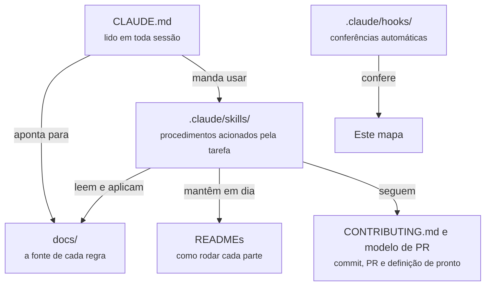

# Mapa do repositório

O que é cada documento, skill, agente e hook do RecifeView, e como eles trabalham juntos. Serve para quem chega ao projeto, pessoa ou assistente de código, entender em poucos minutos onde está cada coisa e o que acontece quando se mexe no repositório.

> **Regra:** criou, renomeou ou removeu um `.md`, uma skill, um agente ou um hook? Atualize este mapa no mesmo commit. O hook [conferir-mapa](#hooks-e-configuração-do-claude-code) avisa o Claude quando algo fica de fora, e a [definição de pronto](CONTRIBUTING.md#definição-de-pronto) cobra o mesmo das pessoas.

## Como as peças se encaixam



Uma tarefa típica de código passa por eles nesta ordem:

1. O Claude Code carrega o [CLAUDE.md](CLAUDE.md) automaticamente: regras fixas, stack e onde está cada coisa.
2. Antes de mexer, lê o documento da área em [docs/](docs/README.md) e o README da pasta.
3. Enquanto escreve, segue a skill `codigo-limpo` (código) ou `interface-recifeview` (tela, gráfico, mapa, texto).
4. Se mudou a forma de rodar ou tomou uma decisão, a skill `atualizar-docs` diz o que atualizar.
5. A skill `commit` separa os commits, barra dado sensível e confere o travessão.
6. Ao encerrar, o hook `conferir-mapa` garante que este mapa continua completo.

## Documentos da raiz

| Arquivo | Para quê | Quem lê | Atualize quando |
|---|---|---|---|
| [CLAUDE.md](CLAUDE.md) | Porta de entrada do assistente: regras que não se negociam, stack, fluxo de trabalho, Clean Code e estado atual | Claude Code, carregado automaticamente em toda sessão | Mudar uma regra, o estado do projeto ou a lista de documentos |
| [README.md](README.md) | Apresenta o projeto, a arquitetura em resumo e como rodar | Qualquer pessoa, primeiro arquivo no GitHub | Mudar a forma de rodar, a estrutura de pastas ou a situação do projeto |
| [CONTRIBUTING.md](CONTRIBUTING.md) | Branches, padrão de commits, pull requests, definição de pronto e tags de entrega | Quem vai commitar | Mudar o fluxo de trabalho do grupo |
| [MAPA-DO-REPOSITORIO.md](MAPA-DO-REPOSITORIO.md) | Este arquivo: o que é cada documento, skill, agente e hook | Quem chega ao projeto | Criar, renomear ou remover qualquer item listado aqui |

## Documentação técnica (`docs/`)

| Arquivo | Para quê | Como contribui |
|---|---|---|
| [docs/README.md](docs/README.md) | Índice da pasta, com "leia quando" | Leva direto ao documento certo |
| [docs/contexto.md](docs/contexto.md) | Problema, equipe, cronograma, entregáveis de AVD, achados da EDA, pendências | Liga o código às entregas e ao que a N3 pediu para o painel |
| [docs/arquitetura.md](docs/arquitetura.md) | C4 nos níveis 1 a 3: containers, telas e rotas, Processor, camadas de dados, segurança | Define o que cada container faz e como eles conversam |
| [docs/clean-architecture.md](docs/clean-architecture.md) | Camadas e pastas dentro de cada container, regra da dependência, portas, testes por camada | Diz onde cada arquivo de código mora e para que lado ele pode importar |
| [docs/stack.md](docs/stack.md) | Ferramentas com status (definido, do C3 ou proposta) e política de versões | Evita instalar o que o grupo ainda não aprovou |
| [docs/padroes-de-codigo.md](docs/padroes-de-codigo.md) | Clean Code, comentários, travessão, nomes e idioma, Python, TypeScript, banco, API, testes, logs | Base da skill `codigo-limpo` e da revisão de PR |
| [docs/design-system.md](docs/design-system.md) | Cores oficiais e derivadas, contraste medido, tipografia, layout, gráficos, mapas, texto e voz, o que evitar | Base da skill `interface-recifeview`; mantém a identidade do RecifeView |
| [docs/dados.md](docs/dados.md) | Dataset, fontes, colunas, privacidade (LGPD), cuidados, correções da N3, definições de métricas | Impede número errado e vazamento de dado sensível |

### Decisões (`docs/adr/`)

| Arquivo | Para quê |
|---|---|
| [docs/adr/README.md](docs/adr/README.md) | Como escrever uma ADR, índice das decisões e lista das decisões em aberto |
| [docs/adr/0000-modelo.md](docs/adr/0000-modelo.md) | Modelo para copiar ao registrar uma decisão nova |
| [docs/adr/0001-stack-do-projeto.md](docs/adr/0001-stack-do-projeto.md) | React, FastAPI, PostgreSQL e Processor no EventBridge |
| [docs/adr/0002-leaflet-para-mapa-coropletico.md](docs/adr/0002-leaflet-para-mapa-coropletico.md) | Leaflet no mapa por bairro |
| [docs/adr/0003-clean-architecture-e-clean-code.md](docs/adr/0003-clean-architecture-e-clean-code.md) | Camadas, regra da dependência e práticas de Clean Code |
| [docs/adr/0004-ferramentas-complementares.md](docs/adr/0004-ferramentas-complementares.md) | TypeScript, Vite, uv, Ruff, Alembic, Docker Compose e o resto das ferramentas confirmadas |
| [docs/adr/0005-autenticacao-com-jwt-proprio.md](docs/adr/0005-autenticacao-com-jwt-proprio.md) | Proposta: JWT próprio atrás de portas, com o funcionamento da sessão e o caminho para trocar pelo Cognito |

As ADRs alimentam a Documentação Final (N9), que pede o histórico de decisões.

## READMEs dos containers

| Arquivo | Para quê |
|---|---|
| [frontend/README.md](frontend/README.md) | Telas, como rodar a SPA, variáveis, comandos e estrutura em camadas |
| [backend/README.md](backend/README.md) | Rotas, regra de privacidade, como rodar a API, banco e migrações |
| [processor/README.md](processor/README.md) | Etapas da ingestão, decisões em aberto, segredos, como rodar a carga |

Enquanto não há código, as seções de execução estão marcadas com "a preencher". Elas são completadas no mesmo commit que trouxer algo executável.

## Skills (`.claude/skills/`)

Skills são procedimentos que o Claude Code carrega quando a tarefa combina com a descrição delas. Também podem ser chamadas pelo nome, com `/nome`. Cada uma fica em `.claude/skills/<nome>/SKILL.md`.

| Skill | É acionada quando | O que faz | Apoia-se em |
|---|---|---|---|
| [codigo-limpo](.claude/skills/codigo-limpo/SKILL.md) | Criar, alterar ou revisar código; pedidos de refatorar ou organizar camadas | Indica a camada certa, confere a regra da dependência, aplica Clean Code, decide se um comentário é indispensável, procura travessão e fecha com uma checagem | [clean-architecture.md](docs/clean-architecture.md), [padroes-de-codigo.md](docs/padroes-de-codigo.md) |
| [interface-recifeview](.claude/skills/interface-recifeview/SKILL.md) | Qualquer tela, componente, gráfico, mapa, texto de interface ou peça de pitch | Traz os tokens de cor e tipografia, as regras de gráfico e mapa, o tom do texto e uma checagem contra cara de gerado por IA | [design-system.md](docs/design-system.md) |
| [atualizar-docs](.claude/skills/atualizar-docs/SKILL.md) | Instalar dependência, criar variável, comando, porta, pasta, rota, tabela, decisão ou métrica; criar skill, agente ou hook | Diz exatamente qual documento atualizar para cada tipo de mudança, incluindo este mapa | Todos os documentos |
| [commit](.claude/skills/commit/SKILL.md) | Commitar, concluir uma unidade de trabalho, preparar PR | Cria branch, barra dado e segredo, confere documentação e travessão, separa commits atômicos e escreve a mensagem no padrão | [CONTRIBUTING.md](CONTRIBUTING.md) |

A skill `cesar-brand-identity`, que está no Drive do grupo, é pessoal do Gustavo e vale para material da CESAR. Ela não faz parte deste repositório.

## Agentes (`.claude/agents/`)

Ainda não há agentes no projeto.

Um agente é um assistente especializado, com instruções, ferramentas e contexto próprios, que o Claude Code pode acionar para uma tarefa isolada (por exemplo, revisar um PR inteiro sem poluir a conversa principal). Cada agente fica em `.claude/agents/<nome>.md`. Quando o primeiro for criado, ele entra numa tabela aqui com: nome, quando é acionado, o que faz, ferramentas que pode usar e em que documentos se apoia.

## Hooks e configuração do Claude Code

| Arquivo | Para quê |
|---|---|
| [.claude/settings.json](.claude/settings.json) | Configuração do Claude Code compartilhada pelo grupo. Registra o hook abaixo no evento `Stop` |
| [.claude/hooks/conferir-mapa.sh](.claude/hooks/conferir-mapa.sh) | Roda quando o Claude vai encerrar a resposta. Lista todo `.md` versionável (respeitando o `.gitignore`), toda skill, todo agente e todo hook, e confere se cada um tem link neste mapa. Também aponta links do mapa para arquivos que não existem mais. Se achar algo, devolve a lista para o Claude atualizar o mapa antes de terminar |

Configurações pessoais ficam em `.claude/settings.local.json`, que o `.gitignore` mantém fora do repositório.

## Configuração do repositório

| Arquivo | Para quê |
|---|---|
| [.github/pull_request_template.md](.github/pull_request_template.md) | Modelo de PR com o checklist da definição de pronto |
| [.gitignore](.gitignore) | Bloqueia dados, segredos (`.env`, `.salt_id_local`) e arquivos gerados |
| [.editorconfig](.editorconfig) | UTF-8, LF, indentação de 2 espaços (4 no Python) |
| [docs/assets/logo-recifeview.png](docs/assets/logo-recifeview.png) | Logo usado no README |

## Como adicionar um item novo

**Documento (`.md`)**
1. Crie o arquivo no lugar certo: regra técnica em `docs/`, decisão em `docs/adr/`, instrução de execução no README da pasta.
2. Adicione uma linha na tabela correspondente deste mapa, com link.
3. Se for um documento que o Claude precisa consultar, adicione também no mapa do [CLAUDE.md](CLAUDE.md) e no [docs/README.md](docs/README.md).

**Skill**
1. Crie `.claude/skills/<nome>/SKILL.md` com o cabeçalho:
   ```yaml
   ---
   name: nome-da-skill
   description: O que ela faz e quando usar, com as frases que devem acioná-la.
   ---
   ```
2. No corpo, escreva o procedimento em passos e aponte para os documentos de `docs/` em vez de copiar regras (cada regra vive num lugar só).
3. Adicione a linha na tabela de skills deste mapa e, se ela fizer parte do fluxo de toda tarefa, cite-a no [CLAUDE.md](CLAUDE.md).

**Agente**
1. Crie `.claude/agents/<nome>.md` com o cabeçalho:
   ```yaml
   ---
   name: nome-do-agente
   description: Quando acionar este agente.
   tools: Read, Grep, Glob
   ---
   ```
2. No corpo, escreva as instruções do agente, apontando para os documentos de `docs/`.
3. Troque o texto "Ainda não há agentes no projeto" por uma tabela e adicione a linha do agente.

**Hook**
1. Crie o script em `.claude/hooks/` seguindo [padroes-de-codigo.md](docs/padroes-de-codigo.md) e registre-o em `.claude/settings.json`.
2. Adicione a linha na tabela de hooks deste mapa, dizendo em que evento roda e o que confere.

## Como conferir à mão

```bash
bash .claude/hooks/conferir-mapa.sh
```

Sem pendências, o comando não imprime nada e termina com sucesso. Com pendências, lista o que falta ou o que sobra e termina com erro.
