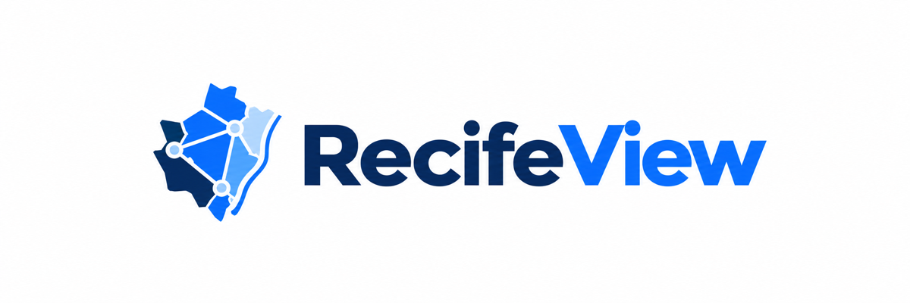
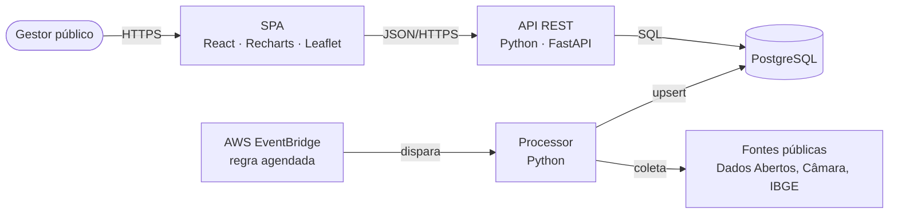

<p align="center">
  
</p>

<p align="center">
  Painel analítico das demandas do cidadão no Recife, para a gestão pública.<br>
  Projetos 5 · CESAR School · 2026.2 · Grupo 08
</p>

---

## Sobre

As demandas que chegam à Prefeitura do Recife passam por portas diferentes: Central 156, Ouvidoria, Defesa Civil, SEDEC e indicações da Câmara Municipal. Cada porta tem a sua base, e essas bases não têm um identificador em comum. Por isso fica difícil saber onde um mesmo problema se repete, quanto tempo ele leva para ser atendido e em que ponto entre o canal e o órgão a resposta se perde.

O RecifeView junta essas bases, trata e pseudonimiza os dados e mostra o resultado num painel para gestores públicos: mapa por bairro e RPA, prazos por serviço, recorrências e o fluxo das indicações da Câmara até a Prefeitura.

O projeto responde ao desafio [Fragmentação do Tratamento de Denúncias Recebidas via Conecta Recife](https://inovacaoaberta.recife.pe.gov.br/), do Banco de Oportunidades da Prefeitura do Recife.

## Situação

| Fase | Situação |
|---|---|
| Pesquisa, dados, EDA (N1 a N3) | Concluída. Os entregáveis estão no Drive do grupo. |
| Repositório | Estrutura e padrões definidos. Ainda não há código. |
| Próxima entrega | Semana 13 (30/10/2026) |

## Arquitetura



O detalhamento (níveis C1 a C3, decisões em aberto) está em [docs/arquitetura.md](docs/arquitetura.md).

## Stack

| Camada | Tecnologia |
|---|---|
| Frontend | React, Recharts, Leaflet |
| Backend | Python, FastAPI |
| Banco | PostgreSQL |
| Processor | Python agendado com AWS EventBridge |

A versão de cada ferramenta e o que ainda está em discussão ficam em [docs/stack.md](docs/stack.md).

## Estrutura do repositório

```
.
├── frontend/      SPA do painel (React)
├── backend/       API REST (FastAPI) e migrações do banco
├── processor/     Ingestão e transformação dos dados (job agendado)
├── docs/          Contexto, arquitetura, padrões, design system e ADRs
├── .claude/       Skills e hooks do assistente de código (ver MAPA-DO-REPOSITORIO.md)
└── .github/       Modelo de pull request
```

## Como rodar

Ainda não há código para rodar. Esta seção é atualizada no mesmo commit que adicionar algo executável.

### Obter o código

```bash
git clone https://github.com/Mateus-Ribeir0/RecifeView.git
cd RecifeView
```

### Pré-requisitos

A definir quando o primeiro container for criado. Versões previstas em [docs/stack.md](docs/stack.md).

### Dados

Os dados não ficam no repositório. Para baixar o dataset e saber onde colocá-lo, leia [docs/dados.md](docs/dados.md#como-obter-os-dados).

### Frontend

Ver [frontend/README.md](frontend/README.md).

### Backend

Ver [backend/README.md](backend/README.md).

### Processor

Ver [processor/README.md](processor/README.md).

## Documentação

| Documento | Conteúdo |
|---|---|
| [docs/contexto.md](docs/contexto.md) | Problema, equipe, cronograma, entregas e achados |
| [docs/arquitetura.md](docs/arquitetura.md) | C4, containers, telas e rotas |
| [docs/clean-architecture.md](docs/clean-architecture.md) | Camadas e pastas dentro de cada container |
| [docs/stack.md](docs/stack.md) | Tecnologias e versões |
| [docs/padroes-de-codigo.md](docs/padroes-de-codigo.md) | Clean Code e convenções de código e de API |
| [docs/design-system.md](docs/design-system.md) | Identidade visual, gráficos e mapas |
| [docs/dados.md](docs/dados.md) | Dataset, privacidade e cuidados |
| [docs/adr/](docs/adr/README.md) | Registro de decisões técnicas |
| [CONTRIBUTING.md](CONTRIBUTING.md) | Branches, commits e pull requests |
| [MAPA-DO-REPOSITORIO.md](MAPA-DO-REPOSITORIO.md) | O que é cada documento, skill, agente e hook, e como eles trabalham juntos |

## Equipe

Davi Santiago · Gustavo Henrique Cruz de Oliveira · Henrique Sérgio C. de Brito · João Pedro R. Dornelas de Araujo · Lucas Ramon · Lucas Rodrigues Campos · Mateus de Almeida Ribeiro

Orientação: Prof. Marcelo Arcoverde. Trilha de AVD: Profª Maíra Farias.

## Dados e licença

Os dados vêm do Portal de Dados Abertos do Recife (licença ODbL), do sistema público SAGL da Câmara Municipal do Recife, do IBGE (Censo 2022) e de uma cópia do Internet Archive. A procedência completa está em [docs/dados.md](docs/dados.md#fontes). A licença do código ainda não foi definida.
