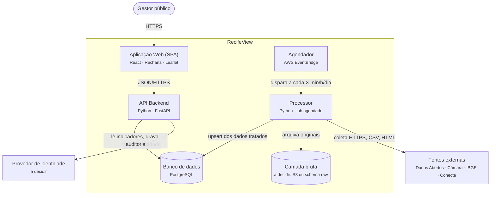

# Arquitetura

Baseada no rascunho C4 v0.1 de 15/10/2026, feito a partir do esboço do Prof. Marcelo (Drive › `Arquitetura C4 - RecifeView`), com a stack confirmada pelo grupo em 26/10/2026. O diagrama editável é o `RecifeView_C4.drawio`. Quando a arquitetura mudar, atualize o `.drawio` e este arquivo juntos.

## C1 · Contexto

- **Gestor público:** acessa o painel pelo navegador, com login.
- **RecifeView:** o sistema.
- **Fontes externas:** Portal de Dados Abertos do Recife, Câmara Municipal (SAGL), IBGE/SIDRA, catálogo de serviços do Conecta Recife, cópia do Internet Archive do dataset da SEDEC e, no futuro, o SGDE/Emprel (depende do pedido LAI). APAC/INMET (chuva) aparece no diagrama, mas o clima é estudo futuro.

## C2 · Containers



| Container | Responsabilidade | Não faz |
|---|---|---|
| SPA | Telas, filtros globais, gráficos, mapa, sessão do usuário | Não calcula indicador; só exibe o que a API devolve |
| API | Autenticação, autorização por rota, auditoria de consulta, agregações, percentis, per capita, reincidência, priorização | Não coleta dado externo; nunca devolve o texto da SEDEC |
| Banco | Camada tratada (fato unificado e dimensões), usuários, auditoria, registro de execuções do Processor | |
| Processor | Coleta, limpeza, pseudonimização, unificação e carga idempotente | Não serve dados a usuários |
| Agendador | Regra do EventBridge que dispara o Processor | |

## C3 · Componentes

### SPA

| Componente | Papel |
|---|---|
| Shell da aplicação | React Router, layout e proteção de rotas (exige sessão válida) |
| Filtros globais | Período, bairro/RPA, serviço e situação. Estado compartilhado; todas as telas reagem a ele |
| Biblioteca de gráficos | Recharts: séries, barras, dispersão, funil, Sankey. Boxplot e heatmap feitos sob medida |
| Mapa coroplético | Leaflet com o GeoJSON dos 94 bairros oficiais ([ADR 0002](adr/0002-leaflet-para-mapa-coropletico.md)) |
| Sessão e cliente da API | Login, token e renovação, chamadas à API e cache de consultas |

### Telas e rotas da API

Cada tela tem um router correspondente na API. Essa correspondência deve ser mantida.

| Tela | O que mostra | Router da API |
|---|---|---|
| Login | Autenticação do gestor | Autenticação |
| Visão Geral | KPIs-síntese e alertas | Indicadores |
| Mapa por Bairro/RPA | Demanda per capita e reincidência por território; dois mapas de prioridade (serviço urbano e emergência) | Território |
| Prazos | Mediana e p90 por serviço e órgão; estoque aberto | Prazos |
| Recorrências | Duplicidade e reincidência por local | Recorrências |
| Fluxo Câmara → Prefeitura | Funil e Sankey de envio e resposta | Fluxo Câmara → Prefeitura |
| (apoio a todas) | Listas de serviços, bairros e órgãos para os filtros | Catálogos e filtros |
| (bônus) | Demanda esperada e classificador | Modelos |

### API

Componentes do C3:

1. **Routers** (`APIRouter`): um por tela. Validam a entrada e chamam um caso de uso. Sem regra de negócio.
2. **Controle de acesso e auditoria:** dependências do FastAPI. Perfil e permissão por rota; registra quem consultou o quê.
3. **Serviços de análise:** casos de uso e regras de negócio (agregações, percentis, per capita, reincidência, priorização). É aqui que se garante que o texto da SEDEC nunca sai.
4. **Repositórios:** SQLAlchemy e SQL parametrizado, views materializadas e paginação.

Esses componentes se distribuem nas camadas da Clean Architecture (`api`, `application`, `domain`, `infrastructure`). A correspondência está em [clean-architecture.md](clean-architecture.md#backend-fastapi).

### Processor

| Etapa | O que faz |
|---|---|
| Ponto de entrada | Recebe o evento (fonte e modo: incremental ou carga completa) e orquestra as etapas |
| Extratores | Um adaptador por fonte: Dados Abertos (CSV anual), Câmara (HTML do SAGL), IBGE/SIDRA (API), catálogo do Conecta (HTML), SEDEC (arquivo de 03/2024, carga única) |
| Limpeza e normalização | As três grafias, datas, mudança de esquema entre 2024 e 2025, 94 bairros oficiais |
| Pseudonimização e mascaramento | Hash com sal no `id_local`, coordenadas com 3 casas, mascaramento do texto SEDEC. O sal vem do gerenciador de segredos |
| Unificador | Esquema comum das 5 fontes: tabela fato e dimensões de bairro e serviço |
| Carregador | Upsert idempotente no PostgreSQL. Rodar de novo não duplica |
| Registro de execuções e qualidade | Log de cada execução, contagens e relatório de qualidade |

O Processor é a versão de produção do pipeline que já existe no Drive (`Dados/02_fontes_separadas/scripts/pipeline.py` e `build_dataset.py`). Reaproveite a lógica desses scripts, porque as contagens deles já foram conferidas.

## Camadas de dados

| Camada | Conteúdo | Onde fica |
|---|---|---|
| Bruta (bronze) | Arquivos como foram publicados | A decidir: S3 ou schema `raw` no PostgreSQL ([pendente](adr/README.md#decisões-em-aberto)) |
| Tratada (prata) | Uma tabela por fonte, limpa e pseudonimizada | Schema do PostgreSQL |
| Analítica (ouro) | Fato unificado, dimensões, views materializadas para as telas | Schema do PostgreSQL |

## Segurança

- O app real exige login. Só gestores autenticados veem o painel.
- O texto da SEDEC não tem rota, não entra em resposta e não vai para log.
- O sal do `id_local` fica no gerenciador de segredos (proposta: AWS Secrets Manager) e nunca no repositório nem no banco.
- Toda consulta é auditada: usuário, rota, filtros e horário.
- Os segredos de cada container chegam por variável de ambiente, e cada pasta tem um `.env.example` sem valores reais.

## Organização do repositório

Monorepo com uma pasta por container. Cada pasta tem as próprias dependências, o próprio README e o próprio `.env.example`.

```
frontend/    SPA
backend/     API e migrações do banco (dono único do esquema)
processor/   Job de ingestão
docs/        Documentação e ADRs
```

As migrações ficam no `backend/` para que o esquema tenha um dono só. O Processor escreve em tabelas que já existem. Isso é uma proposta e ainda precisa da confirmação do grupo.

Dentro de cada pasta, o código segue as camadas de [clean-architecture.md](clean-architecture.md).

## Ponto em aberto do esboço original

No esboço do Prof. Marcelo há uma seta que sai da API para baixo sem destino nem rótulo. Pode ser cache, fila, módulo de ML ou outro serviço. Pergunte a ele antes de desenhar qualquer coisa nesse lugar.
