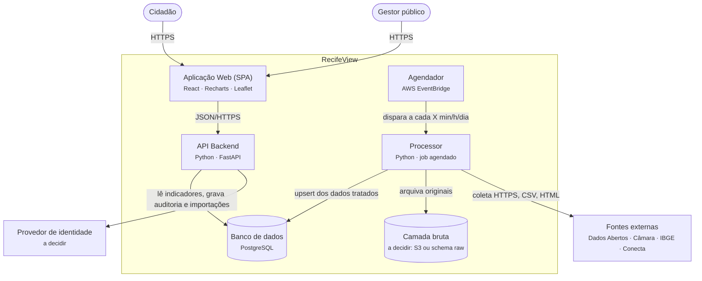

# Arquitetura

Baseada no rascunho C4 v0.1 de 15/10/2026, feito a partir do esboço do Prof. Marcelo (Drive › `Arquitetura C4 - RecifeView`), com a stack confirmada pelo grupo em 26/10/2026. O diagrama editável é o `RecifeView_C4.drawio`. Quando a arquitetura mudar, atualize o `.drawio` e este arquivo juntos.

## C1 · Contexto

- **Gestor público:** acessa o painel pelo navegador, com login.
- **Cidadão:** faz o pedido no canal de sempre (Conecta Recife, Central 156, Ouvidoria) e, no RecifeView, consulta o andamento pelo protocolo e os números do bairro, sem conta ([ADR 0011](adr/0011-encaminhamento-ao-orgao-e-retorno.md), proposta). Pode também enviar relato anônimo pelo formulário ([ADR 0009](adr/0009-formulario-publico-e-pente-fino.md), proposta). Com conta própria, guarda os protocolos e acompanha os relatos da cidade ([ADR 0010](adr/0010-contas-de-cidadao-e-niveis-de-acesso.md), proposta).
- **Órgãos responsáveis:** Emlurb, Compesa, Neoenergia, CTTU, Defesa Civil e outros. Recebem as ocorrências encaminhadas pela gestão (por e-mail, webhook ou caixa local) e respondem por um link, sem conta ([ADR 0011](adr/0011-encaminhamento-ao-orgao-e-retorno.md), proposta).
- **RecifeView:** o sistema.
- **Fontes externas:** Portal de Dados Abertos do Recife, Câmara Municipal (SAGL), IBGE/SIDRA, catálogo de serviços do Conecta Recife, cópia do Internet Archive do dataset da SEDEC e, no futuro, o SGDE/Emprel (depende do pedido LAI). APAC/INMET (chuva) aparece no diagrama, mas o clima é estudo futuro.

## C2 · Containers



| Container | Responsabilidade | Não faz |
|---|---|---|
| SPA | Telas, filtros globais, gráficos, mapa, sessão do usuário | Não calcula indicador; só exibe o que a API devolve |
| API | Autenticação, autorização por rota, auditoria de consulta, agregações, percentis, per capita, reincidência, priorização, importação de arquivos enviados pelo painel ([ADR 0007](adr/0007-importacao-de-arquivos-pelo-painel.md)) | Não coleta dado externo; nunca devolve o texto da SEDEC |
| Banco | Camada tratada (fato unificado e dimensões), usuários, auditoria, registro de execuções do Processor | |
| Processor | Coleta, limpeza, pseudonimização, unificação e carga idempotente | Não serve dados a usuários |
| Agendador | Regra do EventBridge que dispara o Processor | |

## C3 · Componentes

### SPA

| Componente | Papel |
|---|---|
| Shell da aplicação | React Router, layout e proteção de rotas (exige sessão válida) |
| Filtros globais | Período, RPA, bairro e categoria, numa linha acima do conteúdo ([ADR 0008](adr/0008-navegacao-lateral-com-filtros.md)). Estado compartilhado; cada tela mostra só os que aplica |
| Biblioteca de gráficos | Recharts: linhas, barras, dispersão, histograma. O fluxo (Sankey) e o mapa de calor são feitos sob medida em `ui/charts` |
| Mapa coroplético | Leaflet com o GeoJSON dos 94 bairros oficiais ([ADR 0002](adr/0002-leaflet-para-mapa-coropletico.md)) |
| Sessão e cliente da API | Login, token e renovação, chamadas à API e cache de consultas (hook próprio `useConsulta`, porque o TanStack Query segue como proposta) |
| Importações | Envio, passos de decisão, histórico e detalhe, com o estado salvo no servidor |

### Telas e rotas da API

Cada tela tem um router correspondente na API. Essa correspondência deve ser mantida.

| Tela | O que mostra | Router da API |
|---|---|---|
| Página pública (`/`, `/como-funciona`, `/a-cidade-em-numeros`) | O que a plataforma é para quem mora no Recife, o caminho de um pedido até o órgão e de volta, os níveis de acesso, o pente fino, a privacidade e os achados da base aberta | Nenhum (conteúdo estático e a malha dos bairros) |
| Acompanhar um pedido (`/acompanhar`, pública) | Andamento pelo protocolo, com o encaminhamento e a resposta do órgão, e os números de um bairro ([ADR 0011](adr/0011-encaminhamento-ao-orgao-e-retorno.md)) | Acesso à informação (`/publico`) |
| Relatar um problema (`/contribuir`, pública) | Formulário em três passos, sem identificação | Contribuições |
| Entrar, ajuda e definir senha (`/entrar`, `/entrar/gestao`, `/entrar/ajuda`, `/definir-senha`) | Entrada do cidadão e da gestão, orientação de acesso, troca da senha | Autenticação |
| Criar conta e recuperar senha (`/cadastrar`, `/recuperar-senha`) | Cadastro do cidadão, que já abre a sessão, e nova senha com código por e-mail | Contas |
| Área do cidadão (`/cidade`, `/cidade/meus-relatos`, `/cidade/meus-pedidos`, `/cidade/meu-bairro`, `/cidade/relatar`, `/cidade/conta`), só para conta de cidadão | Relatos da cidade sem endereço exato, os próprios relatos com o andamento, os protocolos guardados com o andamento, números do bairro comparados com o Recife, formulário e dados da conta | Cidade, Acesso à informação, Contribuições e Contas |
| Início (`/painel`) | KPIs-síntese e volume por fonte | Indicadores |
| War Room (`/painel/war-room`) | Estado de um dia simulado: entradas, estoque, fila e alertas | War Room |
| Retorno (`/painel/retorno`) | Abas: funil, canais, destinos e caminhos das indicações; canais e prazo da Ouvidoria | Retorno |
| Reincidência (`/painel/reincidencia`) | Local repetido, intervalos e pontos crônicos | Recorrências |
| Prazos (`/painel/prazos`) | Percentis, faixas, categorias e estoque aberto | Prazos |
| Território (`/painel/territorio`) | Taxas por bairro, faixas e tendência, com mapa e tabela | Território |
| Prioridade (`/painel/prioridade`) | Abas: índice AHP com seis comparações, mapa e ranking; fila de ocorrências, com o botão Encaminhar; método e sensibilidade | Prioridade e Encaminhamentos |
| Encaminhamentos (`/painel/encaminhamentos` e `/:id`) | Para qual órgão cada ocorrência foi, prazo, retorno do órgão, etapas e reenvio ([ADR 0011](adr/0011-encaminhamento-ao-orgao-e-retorno.md)) | Encaminhamentos |
| Retorno do órgão (`/retorno/:token`, sem login) | O que chegou ao órgão e o formulário de resposta. O token do link é a credencial | Retorno do órgão |
| Sobre os dados (`/painel/sobre-os-dados`) | Abas: fontes e cobertura, correções, cuidados e privacidade, glossário | Sobre |
| Contribuições (`/painel/contribuicoes`) | Pente fino dos relatos parecidos, ocorrências e geração do pacote | Contribuições |
| Importações (`/painel/importacoes`, `/nova` e `/:id`) | Histórico, envio de arquivo, decisões, relatório e desfazer | Importações |
| (apoio a todas) | Anos, RPAs, bairros, categorias e fontes para os filtros | Catálogos |
| (bônus) | Demanda esperada e classificador | Modelos |

### API

Componentes do C3:

1. **Routers** (`APIRouter`): um por tela. Validam a entrada e chamam um caso de uso. Sem regra de negócio.
2. **Controle de acesso e auditoria:** dependências do FastAPI. Perfil e permissão por rota; registra quem consultou o quê.
3. **Serviços de análise:** casos de uso e regras de negócio (agregações, percentis, per capita, reincidência, priorização). É aqui que se garante que o texto da SEDEC nunca sai.
4. **Repositórios:** SQLAlchemy e SQL parametrizado, views materializadas e paginação.
5. **Importação:** leitores de arquivo, normalização no domínio, fila em processo e carga por `COPY`, tudo atrás de portas. Depois da carga, as views são atualizadas com o painel no ar. Enquanto o Processor não existe, é por aqui que os dados entram ([ADR 0007](adr/0007-importacao-de-arquivos-pelo-painel.md)).
6. **Contribuições:** recebe os relatos do formulário público numa quarentena, aplica o pente fino e gera o pacote que segue pela importação. É a única rota de escrita sem sessão, e nada do que chega por ela aparece no painel sem revisão ([ADR 0009](adr/0009-formulario-publico-e-pente-fino.md)).

Esses componentes se distribuem nas camadas da Clean Architecture (`api`, `application`, `domain`, `infrastructure`). A correspondência está em [clean-architecture.md](clean-architecture.md#backend-fastapi).

### Processor

| Etapa | O que faz |
|---|---|
| Ponto de entrada | Recebe o evento (fonte e modo: incremental ou carga completa) e orquestra as etapas |
| Extratores | Um adaptador por fonte: Dados Abertos (CSV anual), Câmara (HTML do SAGL), IBGE/SIDRA (API), catálogo do Conecta (HTML), SEDEC (arquivo de 03/2024, carga única) |
| Limpeza e normalização | As três grafias, datas, mudança de esquema entre 2024 e 2025, 94 bairros oficiais |
| Pseudonimização e mascaramento | Hash com sal no `id_local`, coordenadas com 3 casas, mascaramento do texto SEDEC. O sal vem do gerenciador de segredos |
| Unificador | Esquema comum das 5 fontes: tabela fato e dimensões de bairro e serviço |
| Carregador | Upsert idempotente no PostgreSQL. Rodar de novo não duplica |
| Registro de execuções e qualidade | Log de cada execução, contagens e relatório de qualidade |

O Processor é a versão de produção do pipeline que já existe no Drive (`Dados/02_fontes_separadas/scripts/pipeline.py` e `build_dataset.py`). Reaproveite a lógica desses scripts, porque as contagens deles já foram conferidas.

## Camadas de dados

| Camada | Conteúdo | Onde fica |
|---|---|---|
| Bruta (bronze) | Arquivos como foram publicados | A decidir: S3 ou schema `raw` no PostgreSQL ([pendente](adr/README.md#decisões-em-aberto)) |
| Tratada (prata) | Uma tabela por fonte, limpa e pseudonimizada | Schema do PostgreSQL |
| Analítica (ouro) | Fato unificado, dimensões, views materializadas para as telas ([ADR 0006](adr/0006-modelo-analitico-no-postgresql.md)) | Schema `ouro` do PostgreSQL |

## Segurança

- O app real exige login. Só contas da gestão veem o painel, o pente fino e a importação: a dependência `exigir_gestao` devolve 403 para conta de cidadão, e um teste cobra isso em cada rota da gestão.
- Contas de cidadão entram logo depois do cadastro, recuperam a senha com código de 6 dígitos por e-mail (hash, 15 minutos, 5 tentativas), têm limite de operações por origem e nunca recebem número exato nem texto de relato ([ADR 0010](adr/0010-contas-de-cidadao-e-niveis-de-acesso.md)).
- Senhas com hash Argon2; bloqueio de 15 minutos depois de 5 tentativas erradas seguidas; senha temporária trocada no primeiro acesso.
- Token de acesso de 15 minutos só na memória do navegador; sessão de 12 horas num cookie `httpOnly` e `SameSite=Strict`, revogável no servidor. Detalhes e alternativas na [ADR 0005](adr/0005-autenticacao-com-jwt-proprio.md) (proposta).
- O texto da SEDEC não tem rota, não entra em resposta e não vai para log.
- O formulário público não pede identificação, recusa CPF, telefone e e-mail no texto, tem limite de envios por origem e um campo-armadilha para robôs. O endereço e o detalhe do relato só aparecem para a gestão autenticada, com auditoria, e são apagados em 90 dias.
- O sal do `id_local` fica no gerenciador de segredos (proposta: AWS Secrets Manager) e nunca no repositório nem no banco.
- Os acessos são auditados (entrada, recusa, bloqueio, saída, troca de senha) sem IP e sem o e-mail digitado. As consultas aos dados também são auditadas, com usuário, rota, filtros e horário.
- Os segredos de cada container chegam por variável de ambiente, e cada pasta tem um `.env.example` sem valores reais.

## Organização do repositório

Monorepo com uma pasta por container. Cada pasta tem as próprias dependências, o próprio README e o próprio `.env.example`.

```
frontend/    SPA
backend/     API e migrações do banco (dono único do esquema)
processor/   Job de ingestão
docs/        Documentação e ADRs
```

As migrações ficam no `backend/` para que o esquema tenha um dono só. O Processor escreve em tabelas que já existem. Isso é uma proposta e ainda precisa da confirmação do grupo.

Dentro de cada pasta, o código segue as camadas de [clean-architecture.md](clean-architecture.md).

## Ponto em aberto do esboço original

No esboço do Prof. Marcelo há uma seta que sai da API para baixo sem destino nem rótulo. Pode ser cache, fila, módulo de ML ou outro serviço. Pergunte a ele antes de desenhar qualquer coisa nesse lugar.
