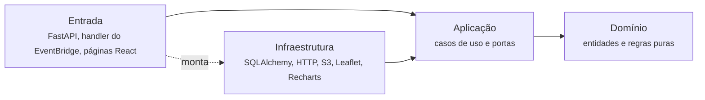

# Arquitetura interna (Clean Architecture)

[arquitetura.md](arquitetura.md) descreve os containers e como eles conversam. Este documento descreve como o código **dentro** de cada container é organizado. A decisão está registrada na [ADR 0003](adr/0003-clean-architecture-e-clean-code.md).

## Por que

- **As regras do projeto ficam testáveis sem banco, sem navegador e sem rede.** Percentil, reincidência, per capita, classes do mapa e pseudonimização são o coração do RecifeView e precisam de teste rápido e confiável.
- **As decisões em aberto viram troca de peça, não reescrita.** S3 ou schema `raw`, Lambda ou Fargate, JWT próprio ou Cognito: cada uma é um adaptador atrás de uma porta. O resto do código não muda quando o grupo decidir.
- **A privacidade fica num lugar só.** A regra de que o texto da SEDEC nunca sai é do domínio. Nenhum detalhe de framework consegue contorná-la.
- **Sete pessoas no mesmo código.** Camadas com fronteiras claras reduzem conflito e deixam óbvio onde cada coisa mora.

## A regra da dependência

O código fonte só aponta para dentro. Uma camada interna não sabe que as externas existem.



| Camada | Contém | Pode importar | Não pode importar |
|---|---|---|---|
| Domínio | Entidades, objetos de valor, regras e constantes do negócio | Só a biblioteca padrão (e o pandas no Processor, ver abaixo) | Aplicação, infraestrutura, entrada, qualquer framework |
| Aplicação | Casos de uso (um por pergunta que o sistema responde) e portas (interfaces das dependências externas) | Domínio | Infraestrutura, entrada, framework web, ORM, cliente HTTP |
| Infraestrutura | Implementações das portas: banco, APIs externas, armazenamento, segredos, bibliotecas de gráfico e mapa | Aplicação e domínio | Entrada |
| Entrada | O que recebe o mundo externo e monta tudo: routers, handler do job, páginas | Todas as anteriores | |

O ponto de montagem (composition root) é o único lugar que conhece todas as implementações e as entrega aos casos de uso: o `main.py` da API, o `handler.py` do Processor e os provedores do app React.

## Backend (FastAPI)

```
backend/app/
  domain/
    filtros.py           Filtros globais como objeto de valor (período, bairro, rpa, serviço...)
    prazos.py            Regras de prazo: o que conta como defeito, censura, percentis
    territorio.py        Per capita, limiar de população mínima
    recorrencias.py      Duplicidade × reincidência
    privacidade.py       O que pode e o que não pode sair
  application/
    portas/              Protocols: PrazoRepository, TerritorioRepository, AuditoriaRepository, ProvedorIdentidade
    casos_de_uso/        listar_prazos_por_servico.py, calcular_demanda_por_bairro.py, ...
  infrastructure/
    db/                  sessão SQLAlchemy, modelos ORM
    repositories/        implementações das portas com SQLAlchemy
    auth/                implementação do ProvedorIdentidade (JWT próprio ou Cognito, conforme a ADR)
    settings.py          Pydantic Settings
  api/
    routers/             um por tela: prazos.py, territorio.py, ...
    schemas/             modelos Pydantic de entrada e saída
    dependencias.py      Depends do FastAPI: sessão, usuário atual, auditoria
  main.py                monta o app e liga portas a implementações
```

Como o C3 se encaixa nas camadas:

| Componente do C3 | Camada |
|---|---|
| Routers REST | `api/routers` |
| Autenticação | Porta em `application/portas`, implementação em `infrastructure/auth`, dependência em `api/dependencias.py` |
| Controle de acesso e auditoria | `api/dependencias.py` chamando o caso de uso de auditoria |
| Serviços de análise | `application/casos_de_uso` usando as regras de `domain` |
| Repositórios | Porta em `application/portas`, implementação em `infrastructure/repositories` |

**Cálculo pesado no banco.** Agregar 2,6 milhões de linhas em Python a cada requisição não é viável. Por isso, o **domínio define a regra** (constantes como `POPULACAO_MINIMA_PER_CAPITA = 1000`, critérios como "prazo negativo é defeito"), o **caso de uso a repassa** para o repositório e o **repositório a executa** em SQL ou numa view materializada. Um teste de integração garante que o SQL respeita a regra do domínio.

**Esquemas Pydantic ficam na entrada.** As entidades do domínio são `dataclass` simples. O router converte a entidade no schema de resposta, que é explícito e por isso nunca vaza uma coluna como `texto`.

## Processor

```
processor/recifeview_processor/
  domain/
    esquema.py           As 45 colunas do esquema unificado e seus tipos
    limpeza.py           Grafias, datas, prazos negativos, coordenadas fora do Recife
    bairros.py           Normalização para os 94 bairros oficiais, inferência de RPA
    pseudonimizacao.py   Hash do id_local (recebe o sal como parâmetro), arredondamento, mascaramento
  application/
    portas/              Extrator, ArmazenamentoBruto, Carregador, RegistroExecucoes, CofreDeSegredos
    executar_carga.py    Caso de uso: extrair, arquivar o bruto, transformar, carregar, registrar
  infrastructure/
    extratores/          dados_abertos.py, camara_sagl.py, ibge_sidra.py, catalogo_conecta.py, sedec_arquivo.py
    armazenamento/       implementação do ArmazenamentoBruto (S3 ou schema raw, conforme a ADR)
    carregador_postgres.py
    segredos.py          Secrets Manager em produção, variável de ambiente local
  entrypoints/
    handler.py           Chamado pelo EventBridge (Lambda ou container, conforme a ADR)
    cli.py               Execução local: carga completa ou incremental de uma fonte
```

**Exceção consciente: pandas no domínio.** As transformações operam sobre `DataFrame`, porque processar 2,6 milhões de linhas como objetos Python seria lento demais. O pandas é tratado como estrutura de dados e é permitido em `domain`. Ler e escrever (CSV de URL, banco, S3) continua sendo infraestrutura: o domínio recebe e devolve `DataFrame`, sem saber de onde ele veio.

**Decisões em aberto viram adaptadores.** Guardar o bruto no S3 ou no schema `raw` é escolher qual classe implementa `ArmazenamentoBruto`. Rodar em Lambda ou em Fargate muda só `entrypoints/`. Enquanto o grupo não decide, implemente apenas a versão local (sistema de arquivos e variável de ambiente) e não escolha a de nuvem por conta própria.

## Frontend (React)

```
frontend/src/
  domain/
    tipos.ts             Bairro, Rpa, Fonte, Periodo, Indicador...
    formatacao.ts        Números e datas em pt-BR
    classes.ts           Quebra em quantis para o mapa
    fontes.ts            Rótulo e cor fixa de cada fonte
  application/
    autenticacao/        Porta ServicoDeAutenticacao, ProvedorDeSessao e useSessao
    filtros/             Estado dos filtros globais
    consultas/           Hooks de caso de uso: useDemandaPorBairro, usePrazosPorServico...
  infrastructure/
    api/                 Cliente HTTP (token e renovação), serviços que implementam as portas
  ui/
    app/                 Rotas, guardas de rota e provedores (ponto de montagem)
    pages/               Uma pasta por tela: visao-geral/, mapa/, prazos/, recorrencias/, fluxo-camara/
    components/          Componentes reutilizáveis: KpiCard, BarraDeFiltros, NotaDeFonte...
    charts/              Únicos arquivos que importam o Recharts
    map/                 Únicos arquivos que importam o Leaflet
    theme/               Tokens do design system
```

Regras:

- Página não chama `fetch` nem conhece URL. Ela usa um hook de `application`, e o hook fala com uma porta (uma `interface`). A implementação da porta mora em `infrastructure/api` e é entregue pelo ponto de montagem (`ui/app`), que é o único lugar da interface que conhece a infraestrutura. Exemplo pronto: `ServicoDeAutenticacao`, implementado em `infrastructure/api/autenticacao.ts` e entregue ao `ProvedorDeSessao` em `ui/app/App.tsx`.
- Componente recebe tipos do domínio, nunca o JSON cru da API. Se a API mudar, a quebra acontece num lugar só: a conversão em `infrastructure/api`.
- Recharts só é importado em `ui/charts` e Leaflet só em `ui/map`. As páginas usam `GraficoSerieTemporal` e `MapaCoropletico`, não as bibliotecas direto. Trocar de biblioteca, ou ajustar o tema, mexe numa pasta só.
- `domain/` não importa React nem qualquer biblioteca externa.
- O ESLint confere tudo isso com o eslint-plugin-boundaries: a configuração está em `frontend/eslint.config.js`.

## Quando criar uma porta

Crie uma interface (Protocol no Python, `interface` no TypeScript) quando a dependência:

- faz entrada ou saída (banco, rede, arquivo, relógio, segredo), ou
- está numa decisão em aberto, ou
- precisa ser trocada por uma versão falsa nos testes.

Não crie interface para função pura, nem para algo com uma única implementação que nunca vai mudar e que não faz entrada ou saída. Também não crie camada ou pasta vazia só para cumprir o desenho: ela nasce quando aparecer o primeiro arquivo que mora nela.

## Testes por camada

| Camada | Tipo de teste | Depende de |
|---|---|---|
| Domínio | Unitário, rápido, sem entrada nem saída | Nada |
| Aplicação | Unitário, com implementações falsas das portas | Domínio |
| Infraestrutura | Integração, com PostgreSQL real (local) e respostas HTTP gravadas | Banco local |
| Entrada | Ponta a ponta da rota (TestClient do FastAPI) ou da tela (Testing Library) | Aplicação com portas falsas |

A maior parte dos testes deve estar no domínio e na aplicação.

## Exemplo de ponta a ponta: tela de Prazos

1. A página `ui/pages/prazos` lê os filtros globais e chama `usePrazosPorServico(filtros)`.
2. O hook chama o cliente em `infrastructure/api`, que faz `GET /api/v1/prazos/servicos?...` e converte a resposta para `PrazoPorServico[]`.
3. Na API, o router `api/routers/prazos.py` valida os parâmetros com um schema e monta o objeto `Filtros` do domínio.
4. O router chama o caso de uso `listar_prazos_por_servico(filtros, repositorio)`.
5. O caso de uso pede ao `PrazoRepository` os percentis, passando a regra do domínio (excluir prazo negativo, tratar pedido aberto como censurado).
6. A implementação SQLAlchemy consulta a view materializada `mv_prazos_servico`.
7. O caso de uso aplica as regras finais do domínio (por exemplo, marcar serviços com n abaixo do mínimo) e devolve entidades.
8. O router converte as entidades no schema de resposta, com o bloco `meta` (fonte, período, filtros, n).
9. A página entrega os dados a `GraficoPercentis` (`ui/charts`), que desenha com o Recharts e o tema.

## Como garantir

- **Revisão:** a checagem da skill `codigo-limpo` e o checklist do PR.
- **Automático:** `uv run lint-imports` no backend (contrato no `pyproject.toml`) e `npm run lint` no frontend (eslint-plugin-boundaries no `eslint.config.js`). Os dois falham quando uma camada importa o que não pode.
