# Fluxos da plataforma

O que cada pessoa consegue fazer no RecifeView, de ponta a ponta: quem começa, o que o sistema faz, quem fica sabendo e onde o fluxo termina. Os diagramas são desenhados pelo GitHub a partir do texto (Mermaid). Clique em "Detalhes" para abrir as regras de cada passo.

Retrato de 22/11/2026. As decisões por trás de cada fluxo estão nas ADRs citadas, quase todas ainda como **proposta**. Os números de prazo e limite são a configuração atual do código e podem mudar por decisão do grupo.

## Sumário

1. [Quem usa a plataforma](#1-quem-usa-a-plataforma)
2. [O ciclo completo, numa página](#2-o-ciclo-completo-numa-página)
3. [Acesso e conta](#3-acesso-e-conta)
4. [Site público, sem conta](#4-site-público-sem-conta)
5. [Relato pelo formulário e pente fino](#5-relato-pelo-formulário-e-pente-fino)
6. [Entrada de dados: a importação](#6-entrada-de-dados-a-importação)
7. [Análise e prioridade no painel](#7-análise-e-prioridade-no-painel)
8. [Encaminhamento ao órgão](#8-encaminhamento-ao-órgão), com a [área corporativa](#85-pela-área-corporativa), o [mesmo problema](#86-o-mesmo-problema) e os [acessos corporativos](#87-acessos-corporativos-criados-pela-administração)
9. [Avisos: quem fica sabendo do quê](#9-avisos-quem-fica-sabendo-do-quê)
10. [Área do cidadão](#10-área-do-cidadão)
11. [Tarefas agendadas e terminal](#11-tarefas-agendadas-e-terminal)
12. [Quem vê o quê](#12-quem-vê-o-quê)
13. [Limites e proteções](#13-limites-e-proteções)
14. [O que ainda não fecha](#14-o-que-ainda-não-fecha)

---

## 1. Quem usa a plataforma

| Quem | Como entra | O que faz |
|---|---|---|
| **Visitante** | Site público, sem conta | Consulta um pedido pelo protocolo, vê os números da cidade e do bairro, relata um problema |
| **Cidadão com conta** | `/entrar` | Tudo do visitante, mais os relatos da cidade, "Meus relatos", "Meus pedidos" e avisos por e-mail |
| **Gestão** | `/entrar/gestao`, conta criada pela administração | Painel, prioridade, encaminhamento, pente fino, importação e comparação entre órgãos. O perfil Administração também cria os acessos corporativos |
| **Órgão com acesso corporativo** | `/entrar/corporativo`, conta criada pela administração e aberta por convite | Vê as ocorrências do órgão, onde ficam e o prazo; responde com a resposta ao cidadão; vê o que já resolveu e os dados da base com o nome do órgão |
| **Órgão sem conta** | Link único que chega na mensagem | Diz se recebeu, se resolveu ou se a ocorrência não é com ele |
| **Agendador** | Comandos de terminal (cron ou EventBridge) | Importa dados, encaminha as ocorrências de nota alta e lembra os órgãos do prazo |

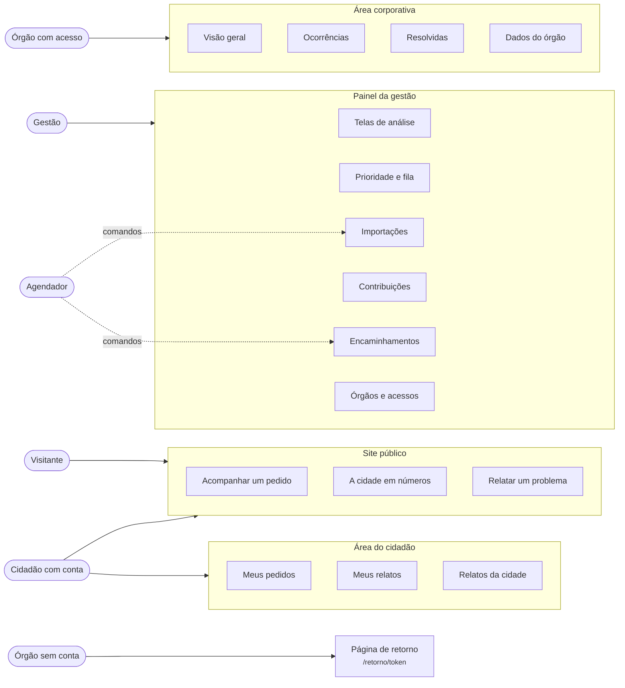

Cada perfil vê só a sua área: as rotas da gestão recusam o cidadão e o órgão, as da área corporativa recusam a gestão e o cidadão, e as da área do cidadão exigem a conta de cidadão ([ADR 0010](adr/0010-contas-de-cidadao-e-niveis-de-acesso.md) e [ADR 0013](adr/0013-acesso-corporativo-dos-orgaos.md)). Todos os perfis com conta têm o sino de notificações no cabeçalho.

---

## 2. O ciclo completo, numa página

O RecifeView não recebe a denúncia: quem recebe é o Conecta Recife, a Central 156, a Ouvidoria e os canais dos órgãos. Ele organiza o que chegou, mostra onde agir, leva a ocorrência a quem resolve e devolve o andamento a quem pediu ([ADR 0011](adr/0011-encaminhamento-ao-orgao-e-retorno.md)).

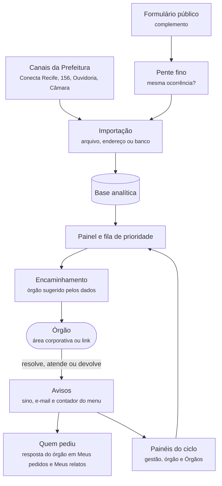

| Etapa | Quem age | Onde | Seção |
|---|---|---|---|
| 1. O pedido nasce | Cidadão | Canais da Prefeitura ou formulário | [5](#5-relato-pelo-formulário-e-pente-fino) |
| 2. Os dados entram | Gestão ou agendador | Importações | [6](#6-entrada-de-dados-a-importação) |
| 3. O que se repete ou demora aparece | Gestão | Telas do painel | [7](#7-análise-e-prioridade-no-painel) |
| 4. A ocorrência vai para quem resolve | Gestão ou agendador | Fila de prioridade, Contribuições | [8](#8-encaminhamento-ao-órgão) |
| 5. O órgão responde, inclusive ao mesmo problema de uma vez | Órgão | Área corporativa ou página de retorno | [8.4](#84-o-órgão-responde) a [8.6](#86-o-mesmo-problema) |
| 6. Todos ficam sabendo | Sistema | Sino, e-mail, menu, telas | [9](#9-avisos-quem-fica-sabendo-do-quê) |
| 7. Quem pediu acompanha | Cidadão | Acompanhar um pedido, área do cidadão | [4.1](#41-acompanhar-um-pedido-pelo-protocolo) e [10](#10-área-do-cidadão) |

---

## 3. Acesso e conta

### 3.1 Entrar

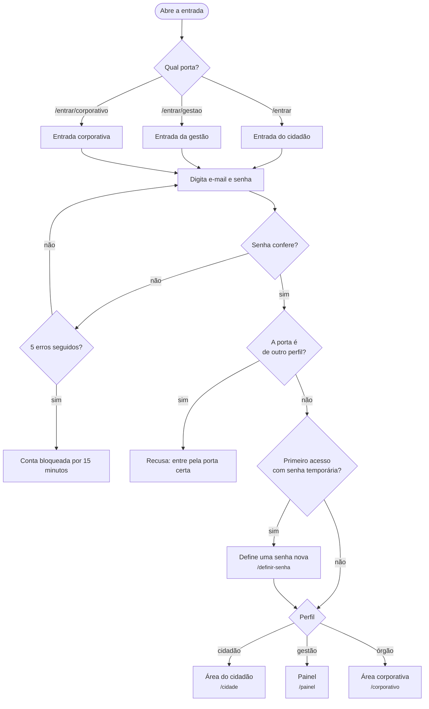

Detalhes da sessão

- O token de acesso dura 15 minutos e fica só na memória do navegador. A sessão dura 12 horas num cookie protegido e renova o token sozinha.
- "Sair" encerra a sessão no servidor. Trocar a senha derruba as outras sessões abertas.
- Quando a sessão acaba, a pessoa volta para a entrada com o aviso do motivo.
- Entradas, recusas, bloqueios, saídas e trocas de senha ficam na auditoria, sem IP e sem o e-mail digitado ([ADR 0005](adr/0005-autenticacao-com-jwt-proprio.md)).
- `/entrar/ajuda` orienta sobre senha esquecida, conta bloqueada e pedido de acesso da gestão.

### 3.2 Conta de cidadão: criar, recuperar, ajustar e excluir

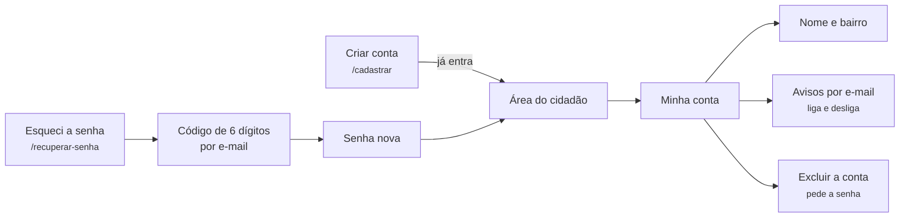

Regras da conta

| Passo | Regra |
|---|---|
| Criar | Pede nome, e-mail, senha e, se a pessoa quiser, o bairro. Não pede CPF nem telefone. A conta nasce pronta, sem confirmação por e-mail |
| Recuperar a senha | Só para conta de cidadão. O código vale 15 minutos, aceita 5 tentativas e sai no máximo um por minuto. A resposta é a mesma exista ou não a conta |
| Avisos por e-mail | Vêm ligados. Desligar em "Minha conta" interrompe os avisos de pedidos e relatos ([seção 9](#9-avisos-quem-fica-sabendo-do-quê)) |
| Excluir | Pede a senha, apaga nome, e-mail, bairro e os protocolos guardados, e derruba as sessões. Os relatos continuam, sem nada que identifique quem enviou |

As contas da gestão não se criam pela tela: a administração cria pelo terminal, com senha temporária trocada no primeiro acesso ([seção 11](#11-tarefas-agendadas-e-terminal)).

---

## 4. Site público, sem conta

O site tem cinco abas: Início, Como funciona, A cidade em números, Acompanhar um pedido e Relatar um problema.

### 4.1 Acompanhar um pedido pelo protocolo

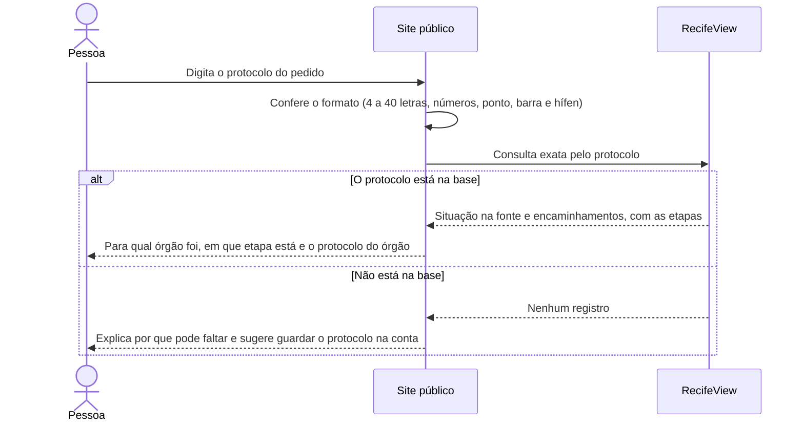

O que aparece e o que nunca aparece

- Aparece: fonte, assunto, data de abertura, situação na fonte, último movimento, prazo da fonte e, se houve encaminhamento, o órgão, a etapa (enviado, recebido, resolvido, devolvido), o prazo e o protocolo do órgão.
- Nunca aparece: endereço, texto do pedido, justificativa da gestão, observação do órgão nem qualquer pseudônimo.
- O protocolo vai no corpo da requisição, para não ficar em log de acesso. Cada origem faz até 30 consultas a cada 10 minutos.
- Hoje a consulta acha os pedidos da Ouvidoria, cujo arquivo público traz o protocolo. Os da Central 156 dependem da integração com o sistema da Prefeitura.

### 4.2 Números da cidade e do bairro

- **A cidade em números:** os achados da base aberta, cada um com fonte e período.
- **Como o meu bairro se compara com o Recife** (dentro de "Acompanhar um pedido"): pedidos à Central 156 por mil moradores por ano, prazo mediano, prazo dos 10% mais demorados e pedidos num local e serviço já pedidos antes. Bairros com menos de 1.000 moradores não têm taxa, porque ela distorce.

---

## 5. Relato pelo formulário e pente fino

O formulário é um complemento: o canal principal continua sendo o da Prefeitura ([ADR 0009](adr/0009-formulario-publico-e-pente-fino.md)).

### 5.1 Enviar um relato

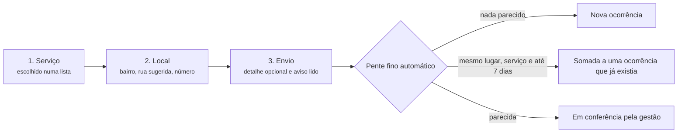

Proteções do envio

- Não pede identificação. O detalhe aceita até 280 caracteres e recusa CPF, telefone e e-mail.
- Cada formulário tem uma chave própria: clique duplo ou conexão que caiu não criam outro relato.
- Cada origem envia até 12 relatos a cada 10 minutos, e um campo escondido barra robôs.
- Com a conta de cidadão aberta, o relato fica ligado à conta e aparece em "Meus relatos". A gestão não vê quem relatou.
- Endereço e detalhe ficam só na quarentena e são apagados em 90 dias.

### 5.2 O caminho do relato

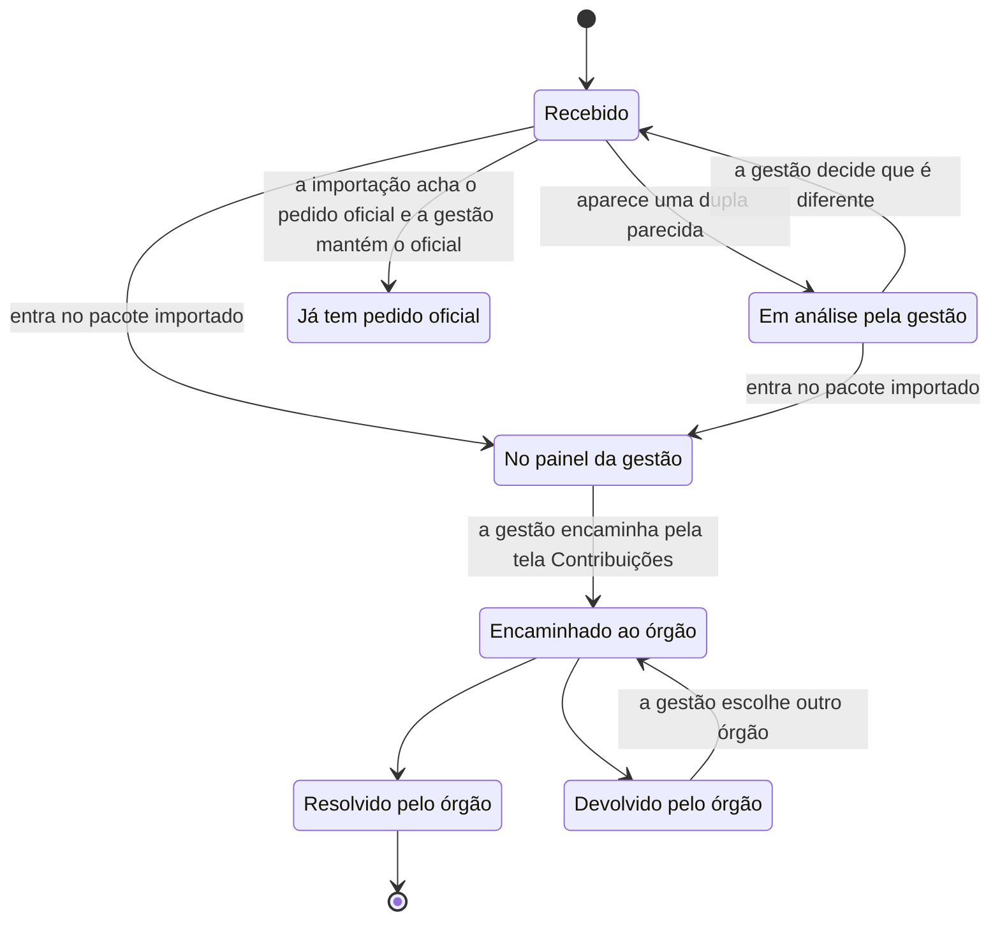

### 5.3 Pente fino na tela Contribuições

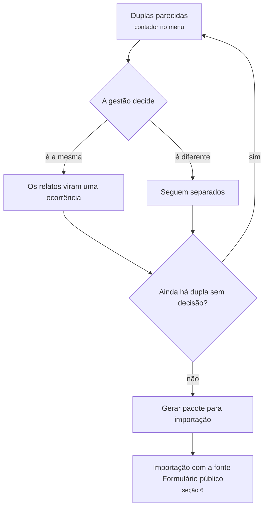

As camadas do pente fino

| Camada | O que faz |
|---|---|
| Chave de envio | Reenvio e clique duplo não contam de novo |
| Endereço canônico | Reescreve a rua como a Central 156 escreve e reconhece a via na lista do bairro |
| Bloqueio | Só compara dentro do mesmo bairro e categoria |
| Regra do tempo | Até 7 dias é duplicidade; de 8 a 29 dias vai para revisão; 30 dias ou mais é reincidência, nunca duplicata |
| Pontuação | Local 60%, serviço 20%, tempo 15%, detalhe 5%. A partir de 0,72, a dupla vai para revisão |
| Decisão humana | Só soma sozinho com endereço igual, número informado, mesmo serviço e até 7 dias |

A mesma conferência roda em toda importação: um arquivo oficial é comparado com os relatos guardados, e o que coincidir vira pendência ([seção 6.3](#63-o-que-pede-decisão)).

---

## 6. Entrada de dados: a importação

### 6.1 De onde os dados vêm

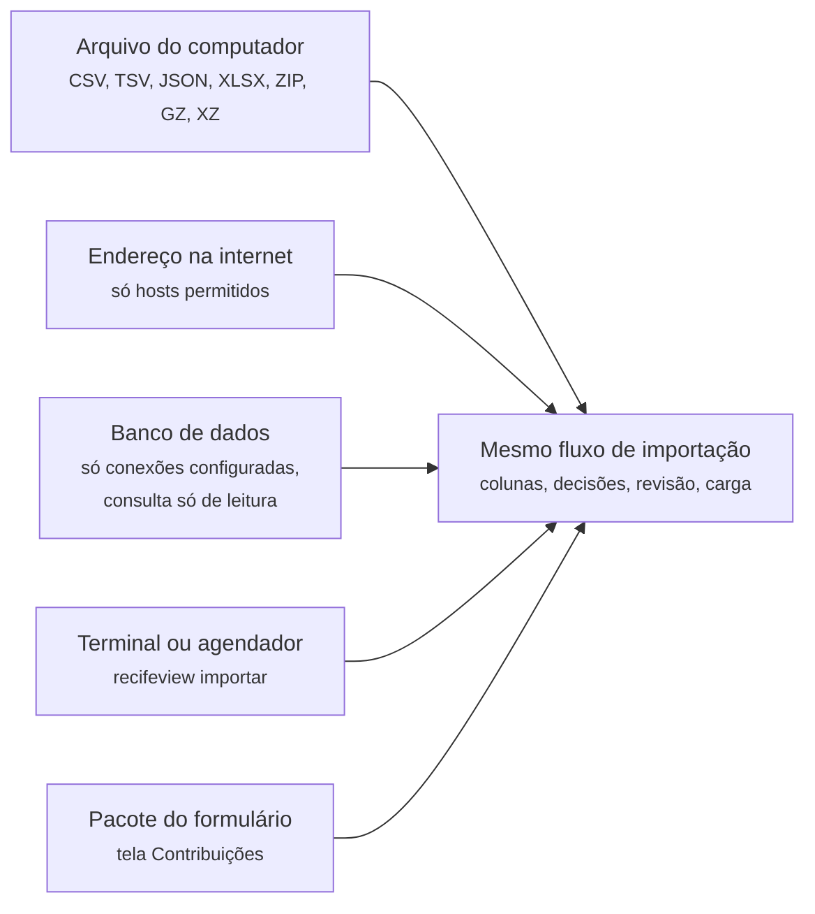

Todas as origens entregam um arquivo ao mesmo fluxo, com as mesmas regras de privacidade e o mesmo desfazer ([ADR 0007](adr/0007-importacao-de-arquivos-pelo-painel.md) e [ADR 0012](adr/0012-origens-de-dados-alem-do-arquivo.md)).

### 6.2 Os cinco passos

A tela mostra cinco passos: **Enviar, Colunas, Decisões, Revisar e Carga**. Por trás, a importação passa por estes estados:

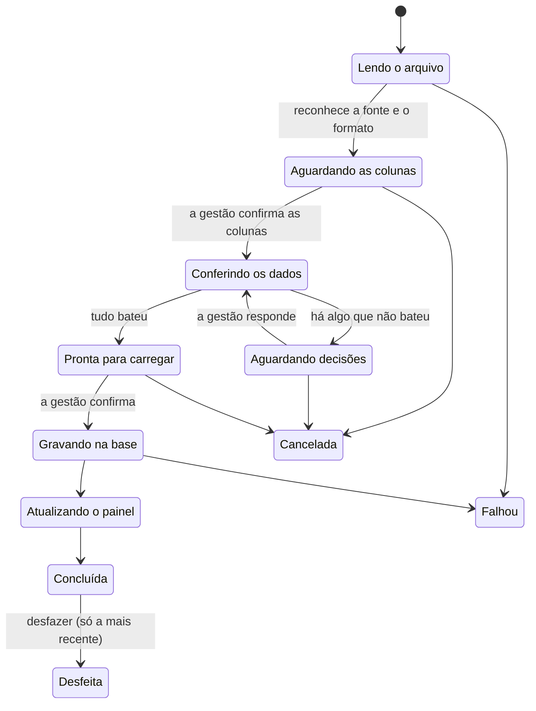

### 6.3 O que pede decisão

As pendências que travam a carga até a gestão responder

| Pendência | Quando aparece |
|---|---|
| Fonte | O arquivo não é de uma fonte reconhecida |
| Data do retrato | Falta o dia em que o arquivo foi baixado |
| Campo obrigatório | Falta data de abertura ou categoria |
| Formato de data | A data pode ser lida de mais de um jeito |
| Bairro desconhecido | O bairro não bate com os 94 bairros oficiais |
| Valor novo | Categoria, situação ou órgão que a base ainda não conhece |
| Datas inválidas | Datas impossíveis, como 1900 ou intervalo negativo |
| Repetidos na base | Registros que já existem: atualizar ou manter |
| Repetidos no arquivo | Linhas iguais dentro do próprio arquivo |
| Coincidências certas e prováveis | O arquivo oficial coincide com relatos do formulário |

Privacidade na importação

- Colunas de nome, CPF, telefone, e-mail, endereço e texto livre são reconhecidas pelo nome e pelo conteúdo, ficam bloqueadas e não têm os valores exibidos.
- O endereço só serve para gerar o pseudônimo do local e é descartado. O texto da SEDEC é descartado na leitura.
- Arquivo com dado pessoal é apagado depois da carga. A API nunca devolve o arquivo original.
- O arquivo da Ouvidoria traz o protocolo, que passa a alimentar a consulta pública ([seção 4.1](#41-acompanhar-um-pedido-pelo-protocolo)).

---

## 7. Análise e prioridade no painel

### 7.1 As telas de análise

| Tela | Pergunta que responde |
|---|---|
| Início | Quais são os principais indicadores e o volume por fonte? |
| War Room | Num dia simulado: o que entrou, o que está parado e por onde começar? |
| Retorno | Para onde vai cada tipo de pedido e quanto volta? |
| Reincidência | Onde o problema volta ao mesmo lugar? |
| Prazos | Quem demora, e a demora está aumentando? |
| Território | Quais bairros pedem mais, por mil moradores, e como isso muda? |
| Prioridade | Onde agir primeiro, com critérios explícitos? |
| Sobre os dados | Quais são as fontes, a cobertura, os cuidados e as correções? |

Os filtros de período, RPA, bairro e categoria ficam numa linha acima do conteúdo, e cada tela mostra só os que usa. Toda consulta fica registrada na auditoria, com quem, o quê e quando.

### 7.2 Da prioridade à fila

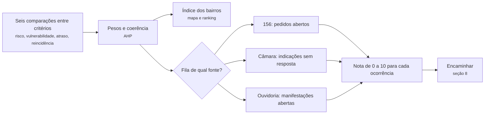

Os julgamentos carregados são uma proposta do grupo e podem ser mudados na tela. Nota 7 ou mais é a "nota alta", o primeiro lote de uma fila de atendimento.

---

## 8. Encaminhamento ao órgão

É aqui que o ciclo fecha ([ADR 0011](adr/0011-encaminhamento-ao-orgao-e-retorno.md)).

### 8.1 Visão do ciclo

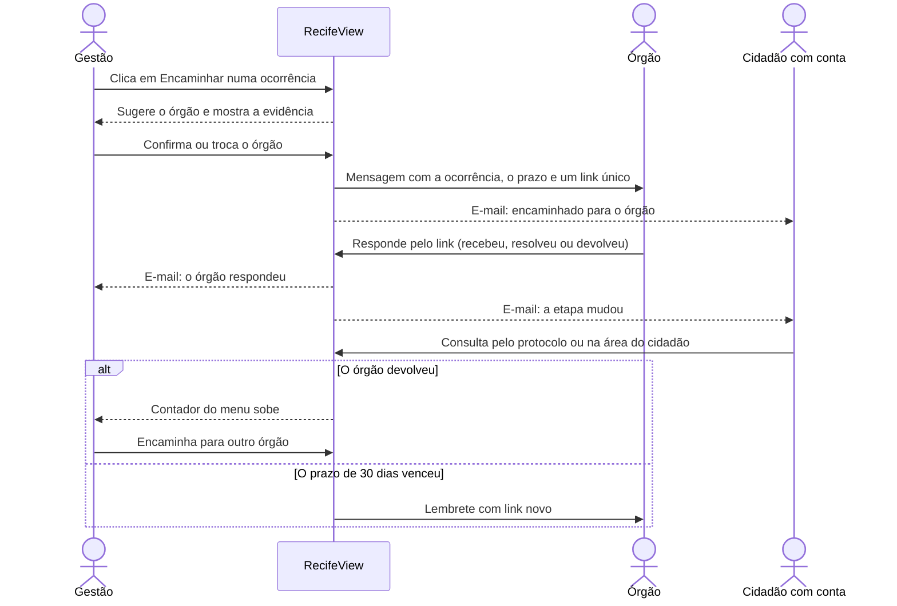

### 8.2 De onde a ocorrência sai

| Origem | Onde a gestão clica | O que vai na mensagem |
|---|---|---|
| Pedido do 156, indicação da Câmara ou manifestação da Ouvidoria | Fila da tela Prioridade | Fonte, protocolo de origem (quando a fonte publica), data, tema, serviço, bairro, situação na fonte, nota e justificativa |
| Relato do formulário que já entrou na base | Tela Contribuições, aba Ocorrências | O mesmo, mais a rua da lista oficial e a faixa de numeração. Nunca o número exato nem o texto |
| Ocorrência devolvida por outro órgão | Detalhe do encaminhamento | O mesmo do encaminhamento anterior |
| Ocorrência de nota alta, sem pessoa | Comando `recifeview encaminhar-prioritarias` | O mesmo, marcado como envio automático |

Como o órgão é sugerido

1. Se o próprio registro aponta um órgão do catálogo (Emlurb, Compesa, Neoenergia, CTTU, Defesa Civil, Seinfra, URB, Saúde, Meio Ambiente, Ordem Pública), ele é o sugerido.
2. Senão, o órgão mais citado nas indicações da Câmara do mesmo tema, se o tema tiver pelo menos 30 indicações.
3. Senão, não há sugestão e a gestão escolhe.

A tela sempre mostra a distribuição do tema como evidência, com fonte e n. A sugestão nunca envia nada sozinha: a gestão confirma. No envio automático, vale a sugestão.

Por onde a mensagem sai

| Canal | Quando | O que acontece |
|---|---|---|
| Área corporativa | Órgão sem canal combinado que tem acesso corporativo ativo | Nenhuma mensagem externa: as pessoas do órgão recebem no sino e por e-mail e respondem em `/corporativo` |
| Caixa de saída local | Órgão sem canal combinado e sem acesso | A mensagem vira um arquivo no servidor |
| E-mail | Órgão com endereço configurado | Sai pelo servidor de e-mail |
| Webhook | Órgão com sistema próprio | O sistema dele recebe os dados em JSON |

O órgão com canal configurado e com acesso corporativo recebe pelos dois: a mensagem pelo canal e a ocorrência na área corporativa.

Se o canal falhar, o encaminhamento fica como "Falha no envio", o contador do menu sobe e o detalhe oferece "Reenviar", com um link novo.

### 8.3 Estados do encaminhamento

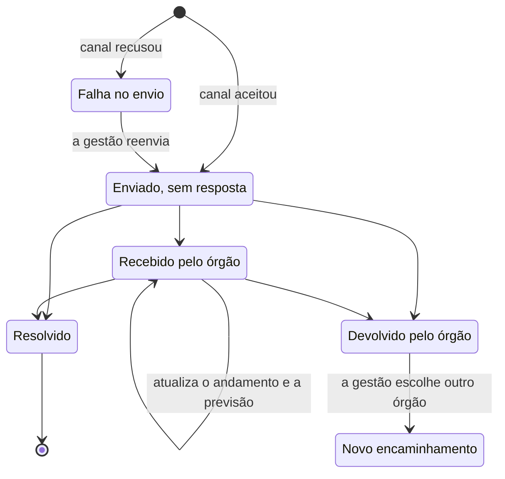

Uma ocorrência não tem dois encaminhamentos abertos ao mesmo tempo. Resolvido e devolvido encerram o ciclo daquele encaminhamento.

### 8.4 O órgão responde

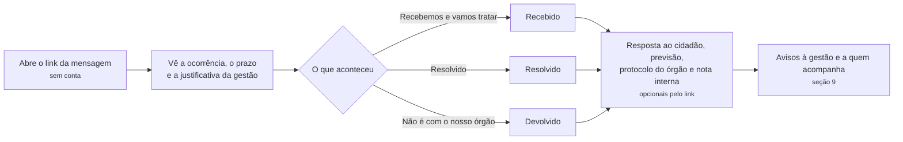

Regras do link e do retorno

- O link vale só para aquele encaminhamento, por 60 dias, e só aceita a resposta seguinte do ciclo. O token fica guardado apenas como hash.
- O sistema do órgão pode responder pelo mesmo endereço, em JSON.
- A nota interna aceita até 280 caracteres e a resposta ao cidadão até 500; as duas recusam CPF, telefone e e-mail. Só a resposta ao cidadão chega a quem pediu; a nota fica com a gestão e o órgão.
- A previsão de conclusão só vale com "recebido", entre hoje e um ano. "Recebido" pode ser repetido para atualizar o andamento.
- Se a resposta chegou por telefone ou ofício, a gestão registra pelo detalhe do encaminhamento.
- O órgão tem 30 dias para resolver ou devolver (Lei 13.460/2017, art. 16). Vencido o prazo, o encaminhamento conta como "prazo vencido" e o órgão recebe um lembrete com link novo, que substitui o anterior. Sai um lembrete por encaminhamento.

### 8.5 Pela área corporativa

O órgão que tem acesso entra em `/corporativo` e trabalha ali, sem depender do link de cada mensagem ([ADR 0013](adr/0013-acesso-corporativo-dos-orgaos.md)).

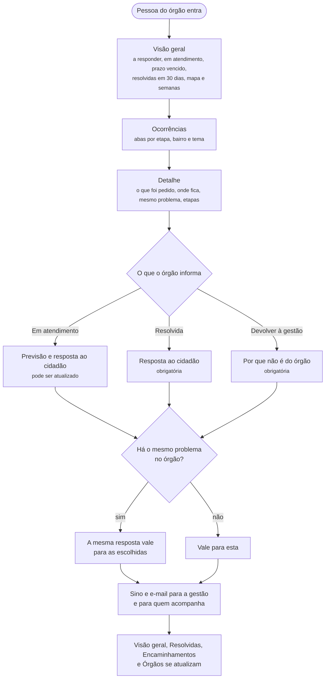

| Tela | Pergunta que responde |
|---|---|
| Visão geral | O que chegou para o órgão, onde estão as abertas e o que vence primeiro |
| Ocorrências | Cada ocorrência por etapa, da que vence antes para a que vence depois |
| Detalhe | O que foi pedido, onde fica, quem mais pediu o mesmo e como responder |
| Resolvidas | O que o órgão já resolveu, quanto saiu no prazo e o que respondeu a quem pediu |
| Dados do órgão | O que a base aberta registra com o nome do órgão, por ano, fonte, bairro, tema e situação |

O que o órgão vê e o que não vê

- Vê só os encaminhamentos feitos ao próprio órgão, menos os que falharam no envio (esses voltam para a gestão reenviar). A ocorrência de outro órgão responde "não encontrada".
- Vê o bairro, a RPA e, no relato do formulário, a rua da lista oficial com a faixa de numeração de 100 em 100. Nunca o número exato nem o texto de quem relatou.
- De quem acompanha o pedido, só a contagem. O protocolo de origem aparece no detalhe, como já ia na mensagem ao órgão, e não na lista.
- Da ocorrência de outro órgão com o mesmo problema, só o nome do órgão e a etapa.
- Dados do órgão: só contagens da view `ouro.mv_demanda_por_orgao`, sem as ações proativas da Defesa Civil e nunca o texto da SEDEC.
- As telas se recarregam sozinhas quando o sino recebe uma notificação nova.

### 8.6 O mesmo problema

Dois encaminhamentos tratam do mesmo problema pela regra do pente fino ([ADR 0009](adr/0009-formulario-publico-e-pente-fino.md)): mesma fonte, mesmo bairro, mesmo tema, menos de 30 dias entre as aberturas e o mesmo local pelo pseudônimo do endereço. "Mesma ocorrência" quando o endereço, o serviço e a semana batem; "provável" quando a pontuação passa de 0,72.

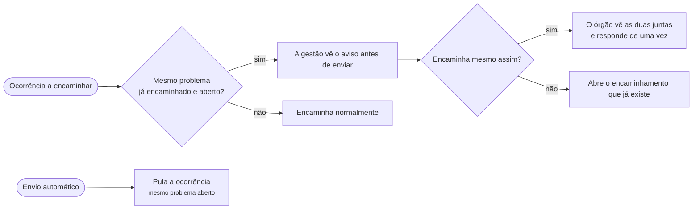

| Onde aparece | Como |
|---|---|
| Antes de encaminhar | Aviso "O mesmo problema já está com um órgão", com o link |
| Lista e detalhe dos Encaminhamentos | Coluna "Mesmo problema" e a lista no detalhe, com os motivos |
| Fila e detalhe do órgão | Marca no cartão e a opção de aplicar a mesma resposta (as certas já vêm marcadas) |
| Visão geral do órgão e tela Órgãos | Grupos de encaminhamentos abertos do mesmo problema |
| Detalhe, na gestão e no órgão | Quantos registros da base têm o mesmo local e tema em até 30 dias, encaminhados ou não |
| `recifeview encaminhar-prioritarias` | Não envia de novo o que já tem o mesmo problema aberto |

A resposta em grupo é tudo ou nada: se uma das escolhidas mudou de etapa ou não é do mesmo problema, nenhuma é gravada. Cabem até 20 por vez.

### 8.7 Acessos corporativos, criados pela administração

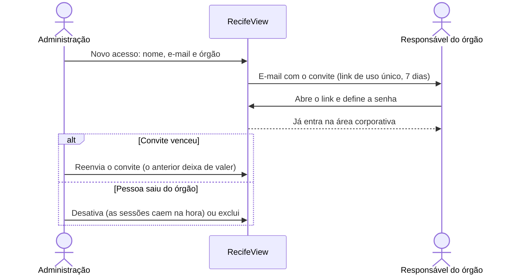

Regras dos acessos

- Só o perfil Administração cria, edita, reenvia convite, desativa, reativa e exclui. A Gestão pública vê a lista.
- Situações: convite enviado, convite vencido, ativo e desativado. A tela mostra o último acesso de cada pessoa.
- O e-mail não muda: ele é o acesso. Editar corrige o nome e o órgão.
- Excluir apaga o nome e o e-mail e mantém a linha para a auditoria. Sem provedor de e-mail, o convite fica em `data/emails`.
- Quem esqueceu a senha cria outra em "Esqueci minha senha", como o cidadão.
- Só a conta com convite aceito (ou criada pela linha de comando) recebe os avisos do órgão.

---

## 9. Avisos: quem fica sabendo do quê

### 9.1 Sino e e-mail

Cada aviso vira uma notificação no sino de quem recebe e, se a pessoa não desligou os avisos, também um e-mail com o mesmo texto.

| Quando | Gestão que encaminhou | Órgão | Cidadão com conta que acompanha | Quem pediu sem conta |
|---|---|---|---|---|
| A gestão encaminha | Não (ela mesma fez) | Sino e e-mail das contas do órgão; mensagem pelo canal, se houver | Encaminhado para o órgão | Vê na consulta pelo protocolo |
| O canal falha | Vê na tela e no contador | Nada chega | Nada (ainda não foi) | Nada |
| O órgão responde (área corporativa ou link) | O órgão respondeu | Não | A etapa mudou, com a resposta ao cidadão e a previsão | Vê na consulta, com a resposta |
| O órgão atualiza o andamento | O órgão respondeu | Não | Nova previsão e resposta | Vê na consulta |
| A gestão registra a resposta | Não (ela mesma fez) | Não | A etapa mudou | Vê na consulta |
| O prazo vence | Vê no contador | Sino e e-mail das contas do órgão; lembrete com link novo pelo canal, se houver | Não | Não |
| A gestão manda a outro órgão | Não | O novo órgão recebe | Novo destino | Vê na consulta |

Quem conta como "cidadão que acompanha"

- Quem guardou o protocolo do pedido em "Meus pedidos".
- Quem enviou, com a conta aberta, um relato que virou ou foi somado à ocorrência encaminhada.
- Desde que a conta esteja ativa e com os avisos ligados em "Minha conta".

O aviso ao cidadão traz a etapa, o órgão, a resposta escrita para ele e a previsão, e o link da própria área. Nunca leva o endereço, o texto do relato, a justificativa da gestão nem a nota interna do órgão. A gestão e o órgão não sabem quem acompanha um pedido: veem só quantas pessoas.

Hoje não há provedor de e-mail escolhido. Sem ele, os avisos ficam em arquivos na pasta `data/emails` do servidor. Com o servidor de e-mail configurado (`API_SMTP_*`), eles saem de verdade.

### 9.2 Dentro da plataforma

O sino fica no cabeçalho das três áreas com conta. Ele consulta as notificações a cada 30 segundos com a aba aberta, mostra quantas são novas e leva à tela certa ao clicar. Quando chega uma nova, as telas do ciclo (fila e visão do órgão, encaminhamentos, Órgãos, Meus pedidos e Meus relatos) se recarregam sozinhas.

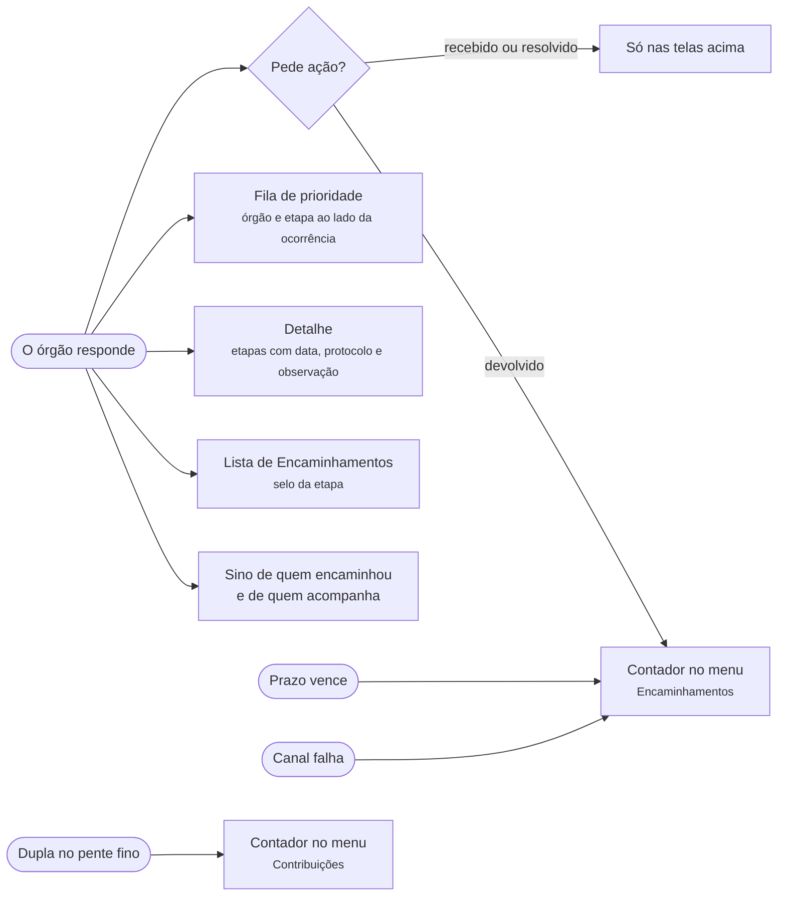

O contador de Encaminhamentos soma, no último encaminhamento de cada ocorrência, as devoluções sem novo destino, as falhas de envio e os prazos vencidos. O filtro "Só os que pedem ação" mostra exatamente esses. O contador se atualiza a cada troca de tela.

---

## 10. Área do cidadão

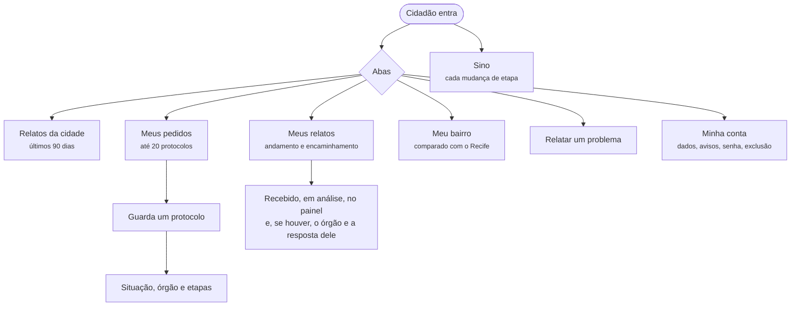

O que cada aba mostra

| Aba | Mostra | Não mostra |
|---|---|---|
| Relatos da cidade | Serviço, bairro, rua (só se estiver na lista oficial), faixa de numeração de 100 em 100, quantas pessoas relataram, quantas não tiveram retorno, situação | Número exato, texto, quem relatou |
| Meus relatos | O relato completo da própria pessoa, a situação e, se a ocorrência foi encaminhada, o órgão, as etapas, a resposta do órgão e a previsão | Nada de outras pessoas |
| Meus pedidos | Cada protocolo guardado com o andamento, como na consulta pública, e se os avisos por e-mail estão ligados | Endereço e texto do pedido |
| Meu bairro | Os quatro indicadores do bairro comparados com o Recife, com a opção de salvar o bairro na conta | Números de pessoas |
| Minha conta | Nome, bairro, avisos por e-mail, troca de senha e exclusão da conta | |

Um protocolo pode ser guardado antes de entrar na base: ele aparece com o andamento assim que a fonte o publicar.

---

## 11. Tarefas agendadas e terminal

Enquanto o Processor não existe, o agendador (cron ou EventBridge) roda os comandos do backend.

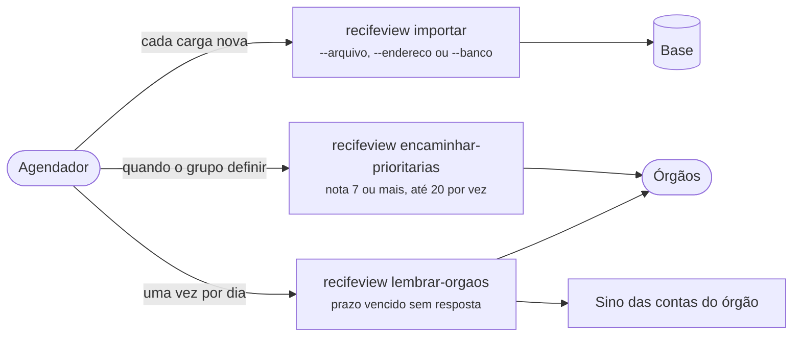

| Comando | Para que serve |
|---|---|
| `recifeview importar` | Importa um arquivo, um endereço permitido ou uma consulta a um banco configurado. Para com aviso se houver algo para decidir |
| `recifeview encaminhar-prioritarias` | Encaminha ao órgão sugerido as ocorrências de nota alta sem encaminhamento aberto e sem o mesmo problema aberto |
| `recifeview lembrar-orgaos` | Lembra o órgão dos encaminhamentos com prazo vencido, no sino e pelo canal |
| `recifeview carregar-logradouros` | Monta a lista de vias que o formulário sugere e o pente fino usa |
| `recifeview cadastrar-usuario` | Cria uma conta da gestão (ou corporativa, com `--orgao`) com senha temporária |
| `recifeview mudar-perfil` | Troca uma conta da gestão entre Gestão pública e Administração |
| `recifeview redefinir-senha` | Gera uma nova senha temporária para uma conta da gestão |

Como rodar cada um está no [README do backend](../backend/README.md#comandos).

---

## 12. Quem vê o quê

| Recurso | Visitante | Cidadão | Gestão | Órgão com acesso | Órgão sem conta |
|---|---|---|---|---|---|
| Números da cidade e do bairro | Sim | Sim | Sim | | |
| Consulta de pedido pelo protocolo, com a resposta do órgão | Sim | Sim | Sim | | |
| Relatar um problema | Sim | Sim | Sim | | |
| Relatos da cidade (rua oficial e faixa) | | Sim | Sim | | |
| Meus relatos e Meus pedidos | | Sim | | | |
| Sino de notificações | | Sim | Sim | Sim | |
| Avisos por e-mail | | Sim | Quando o órgão responde | Ocorrência nova e prazo vencido | Mensagem e lembrete |
| Número exato e texto do relato | | | Sim | | |
| Painel, prioridade e fila | | | Sim | | |
| Encaminhamentos e comparação entre órgãos | | | Sim | | |
| Criar e alterar acessos corporativos | | | Só Administração | | |
| Pente fino e importação | | | Sim | | |
| Ocorrências do próprio órgão, com o mesmo problema | | | | Sim | Uma por link |
| Dados da base com o nome do órgão | | | Sim | Sim | |

---

## 13. Limites e proteções

| Regra | Valor atual | Onde vale |
|---|---|---|
| Bloqueio por senha errada | 5 erros seguidos, 15 minutos | Entrada |
| Token de acesso e sessão | 15 minutos e 12 horas | Toda área com conta |
| Código de nova senha | 6 dígitos, 15 minutos, 5 tentativas, um por minuto | Recuperar senha |
| Operações de conta por origem | 10 a cada 10 minutos | Cadastro e recuperação |
| Relatos por origem | 12 a cada 10 minutos | Formulário |
| Consultas sem conta por origem | 30 a cada 10 minutos | Consulta pelo protocolo, link do órgão e convite |
| Guarda do endereço do relato | 90 dias | Quarentena do formulário |
| Protocolos por conta | 20 | Meus pedidos |
| Prazo do órgão | 30 dias | Encaminhamento |
| Validade do link do órgão | 60 dias | Página de retorno |
| Lembrete ao órgão | Um por encaminhamento | Prazo vencido |
| Texto de justificativa e nota interna | Até 280 caracteres, sem CPF, telefone e e-mail | Encaminhamento e retorno |
| Resposta ao cidadão | Até 500 caracteres, sem CPF, telefone e e-mail; obrigatória para resolver e devolver na área corporativa | Retorno do órgão |
| Previsão de conclusão | Entre hoje e um ano, só com "em atendimento" | Retorno do órgão |
| Resposta em grupo | Até 20 ocorrências do mesmo problema, tudo ou nada | Área corporativa |
| Convite do acesso corporativo | Uso único, 7 dias; um novo invalida o anterior | Acessos corporativos |
| Consulta do sino | A cada 30 segundos, com a aba aberta | Toda área com conta |

---

## 14. O que ainda não fecha

| Lacuna | Efeito hoje | Depende de |
|---|---|---|
| Provedor de e-mail | Os avisos e a recuperação de senha viram arquivos no servidor | Decisão do grupo ([ADR 0010](adr/0010-contas-de-cidadao-e-niveis-de-acesso.md)) |
| Canal real de cada órgão | Quem não tem acesso corporativo recebe pela caixa de saída local | Acordo com cada órgão ([ADR 0011](adr/0011-encaminhamento-ao-orgao-e-retorno.md)) |
| Endereço exato para o órgão | O órgão vê o bairro e, no relato, a rua oficial com a faixa de numeração | Acordo formal com a Prefeitura ([ADR 0013](adr/0013-acesso-corporativo-dos-orgaos.md)) |
| Órgão novo no catálogo | Exige mudança de código | Tabela de órgãos editável, se o grupo quiser |
| Pesos da regra de mesmo problema | Vêm do pente fino, sem calibração com dados rotulados | Amostra rotulada ([ADR 0009](adr/0009-formulario-publico-e-pente-fino.md)) |
| Protocolo da Central 156 | A consulta pública só acha pedidos da Ouvidoria | Integração com o sistema da Prefeitura ou o pedido LAI ao SGDE |
| Quem pede sem conta | Não recebe aviso, por não deixar contato | É escolha de privacidade: acompanha pela consulta |
| Processor | Os dados entram pela importação e pelos comandos | Decisões sobre a camada bruta e onde ele roda ([ADRs em aberto](adr/README.md#decisões-em-aberto)) |
